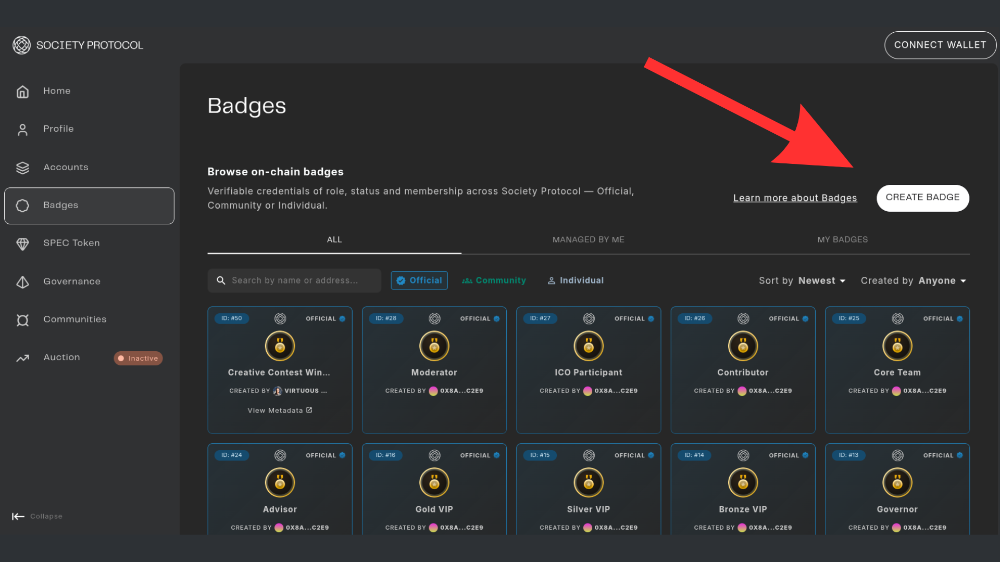
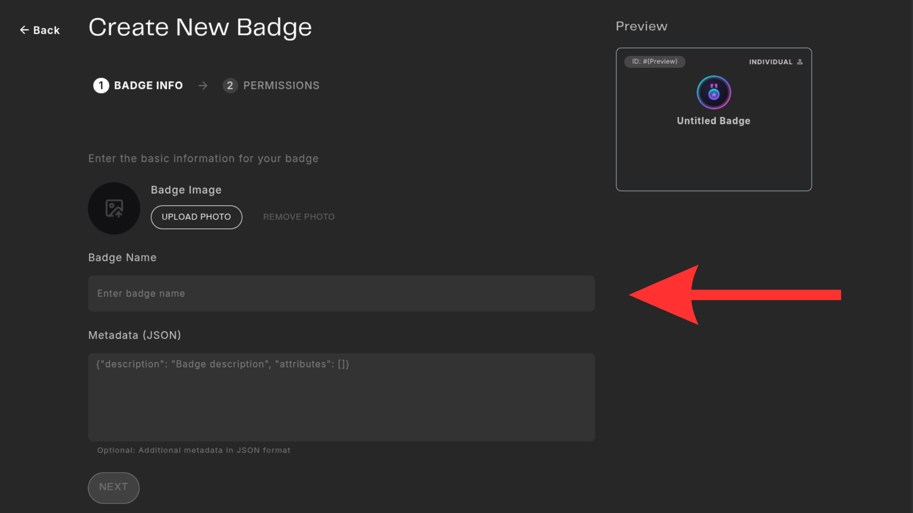
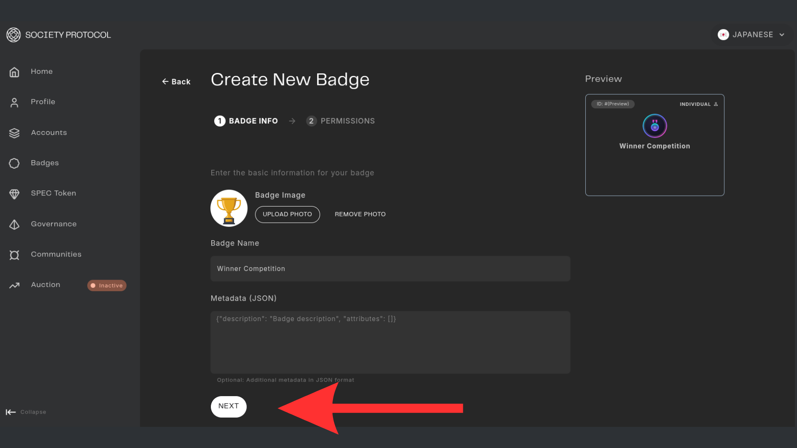
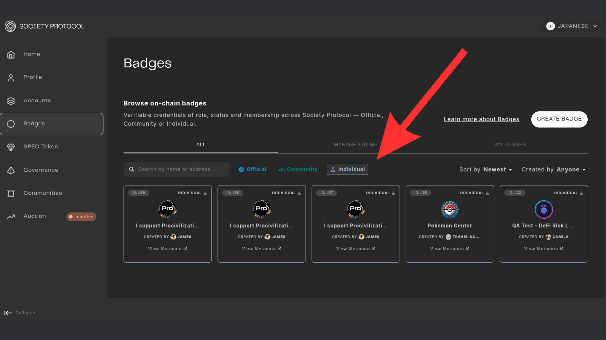

# Create a Badge

This guide explains how to deploy custom ERC-1155 badges using the Web3 Outpost interface.

## Prerequisites
You need to have a personal account in the Web3 Outpost.

## Step-by-Step Guide

Once you mint your Identity, you can go to the badge section on the left side and start the process of badge creation.

### Step 1

Connect the same wallet you used the for the account creation. Click on the left sidebar "Badges" section.

### Step 2
Enter the name of the badge and the badge image use to represent the badge. The metadata sections allows you to fit additional information about the badge. 

### Step 3
Once you finish with the name and image, click the button "Next"

### Step 4
On this section you can define the following permissions: "Mint", "Burn", "Transfer" and who can "Manage" the badge. This is really customizable and it allows for all kinds of combinations depending the specific usage you want to give it.

### Step 5
You can watch your Badges on the "Individual" section as well as in the toogle "Managed by Me".

