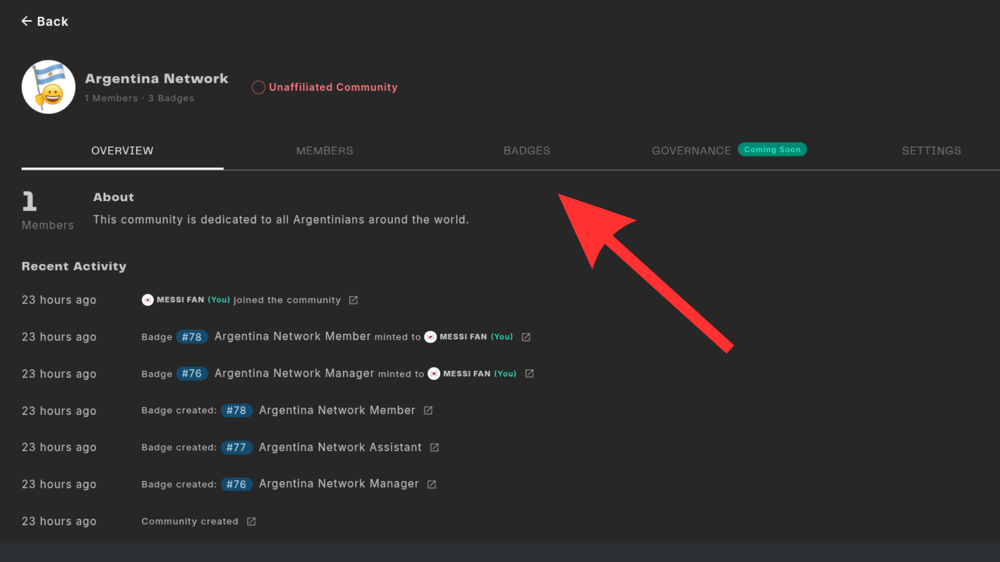
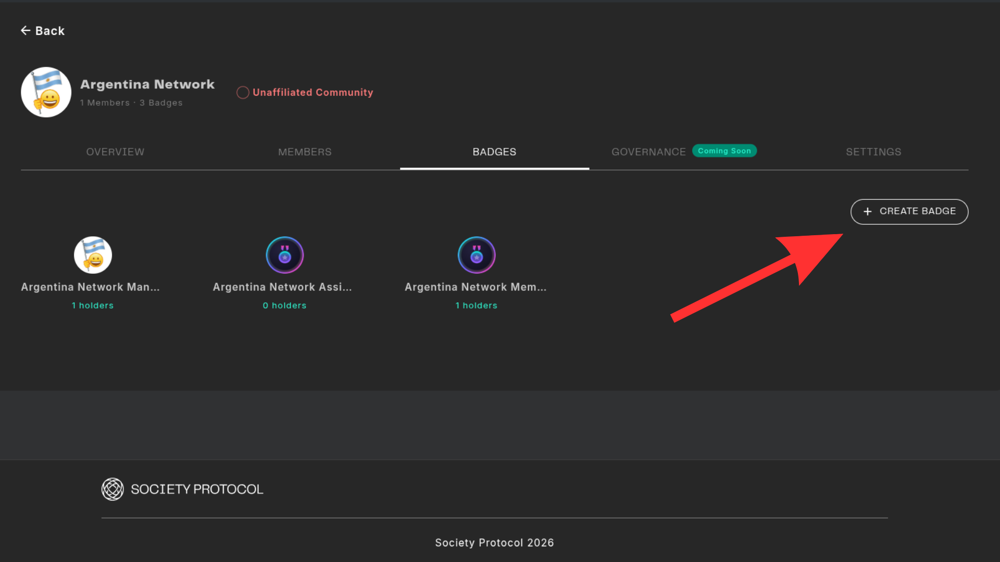
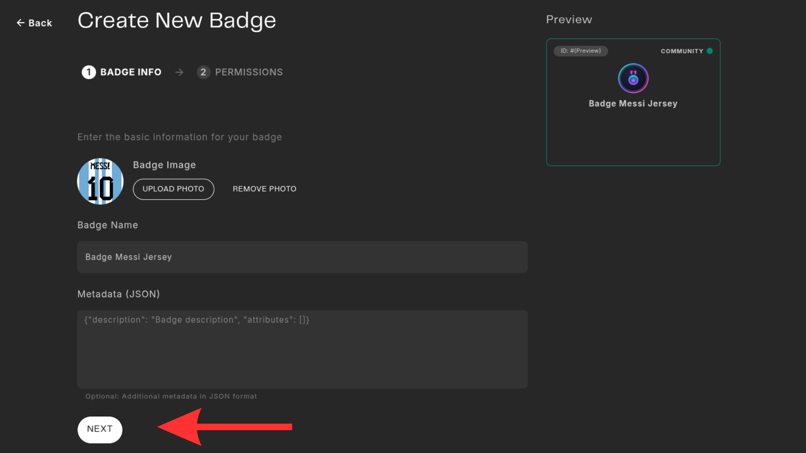
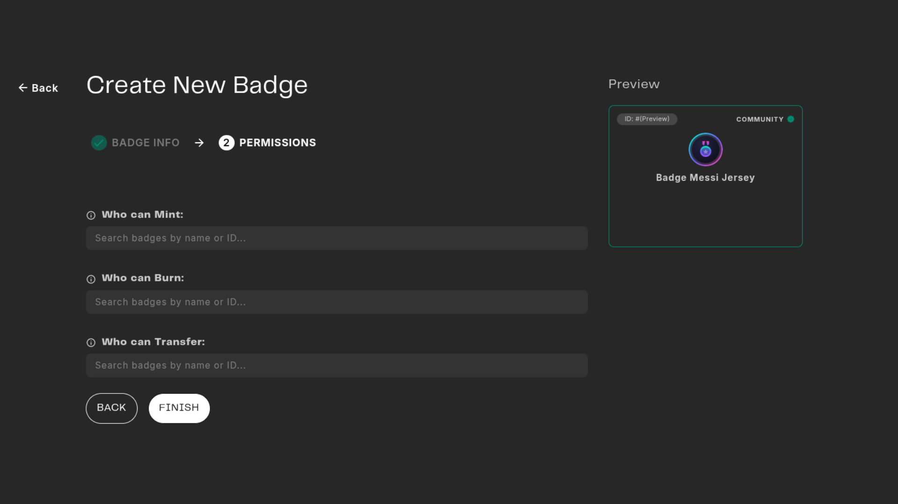
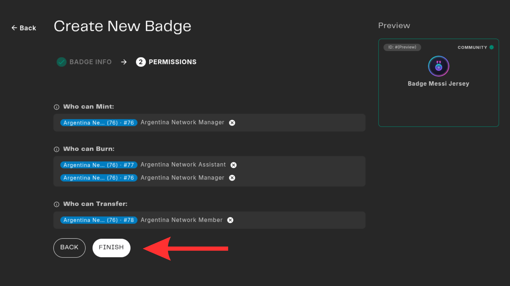

# Create a Community Badge

This tutorial will guide you through the process of creating a custom badge for your community on the Web3 Outpost.

## Prerequisites
You need to have a community in the Web3 Outpost, and the administrative rights to your community dashboard. 

**Step-by-Step:**

### Step 1

Access to you community dashboard and go to the "Badges" toogle.

### Step 2
Click the button "Create Badge".

### Step 3
Enter the details of the badge. Name, image and metadata. 

### Step 4
On this section you can define the following permissions: "Mint", "Burn", "Transfer" and who can "Manage" the badge. This is really customizable and it allows for all kinds of combinations depending the specific usage you want to give it   . 

### Step 5
Double check the best configuration for your usecase and click on "Finish".

