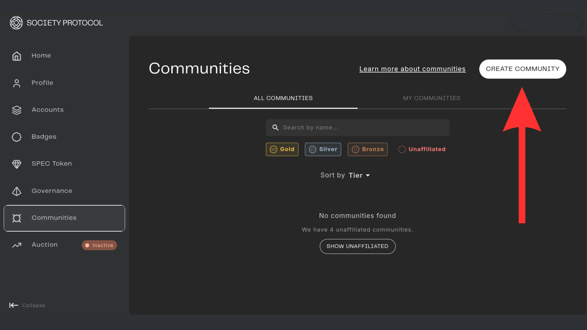
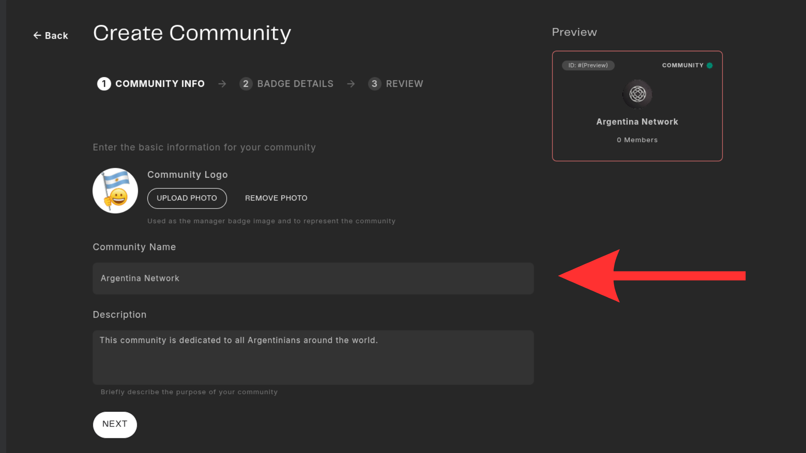
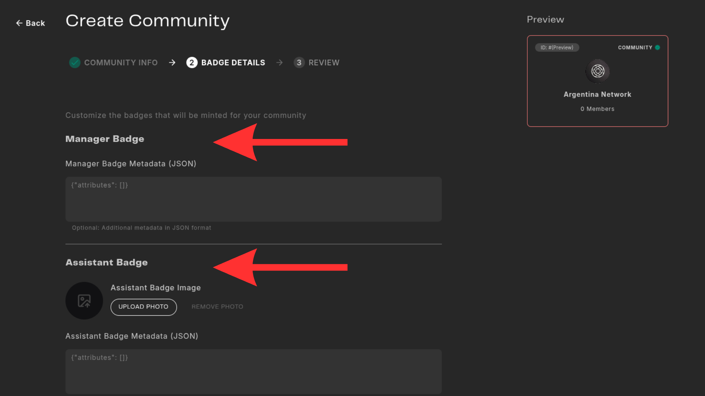
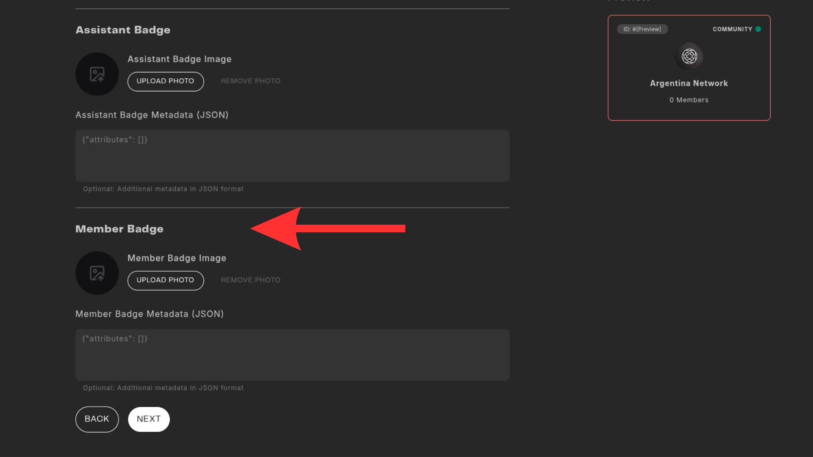
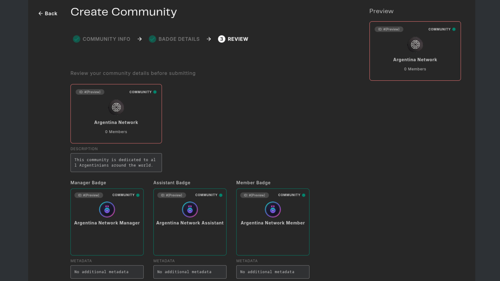
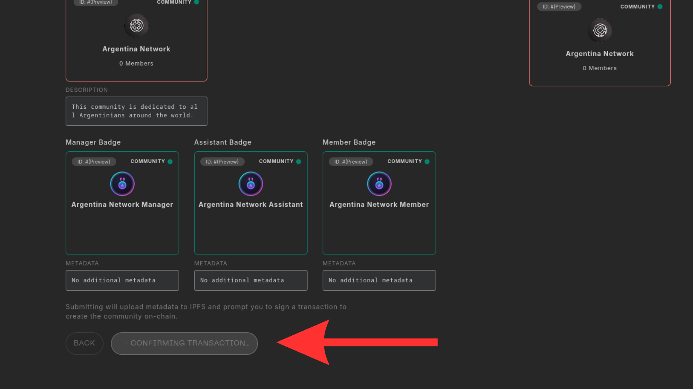
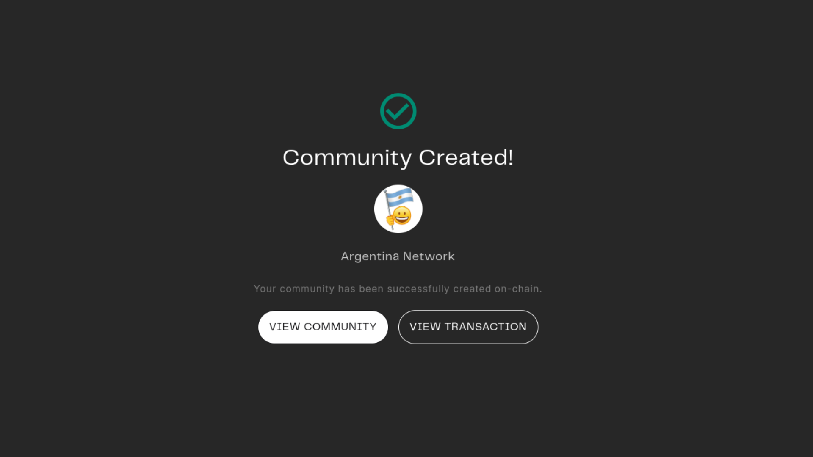
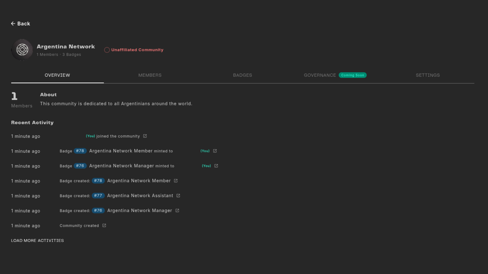

# Create a Community

This tutorial will guide you through the process of creating a community within the Web3 Outpost.

## Prerequisites
You need to have a personal account in the Web3 Outpost.

## Step-by-Step Guide

Once you mint your Identity, you can go to the badge section on the left side and start the process of badge creation.

### Step 1
Go to the "Communities" section on the left sidebar. Click on "Create Community"button on the top-right corner.

### Step 2
Fill in your community creation name and description. Click Next.

### Step 3
You get the Manager Badge an can customized additional data on the metadata section. Add an image for the Assistant Badge and the Member Badge so people can differentiate them in the badge list. Click Next.

### Step 4
The member badge will be your most used badge, so make sure it is well represented.

### Step 5
Double check you finish setting up all the metadata and click "Create".

### Step 6
Click "Finish" and sign all the required transactions to validate the action. The process can take a few minutes depending on the network conditions.

### Step 7
If the transaction went through, you will see the following message: "Community Created!". You can view now the community on the web3 outpost or in Etherscan.

### Step 8
You now have a dashboard where all the actions related to you community get logged. You can see members, badge and future features we will add in the future.

