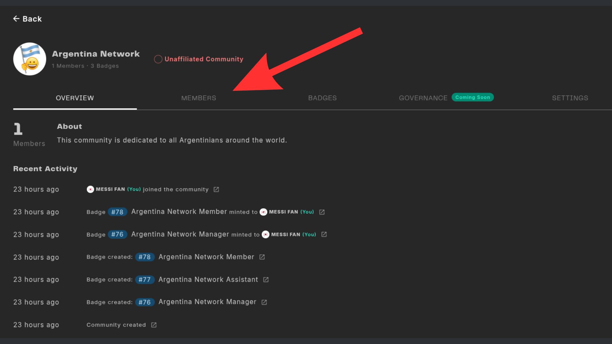
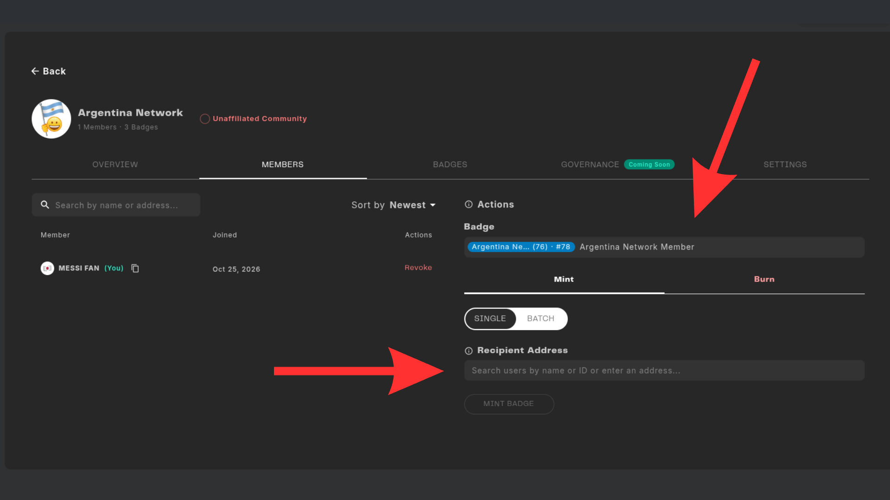
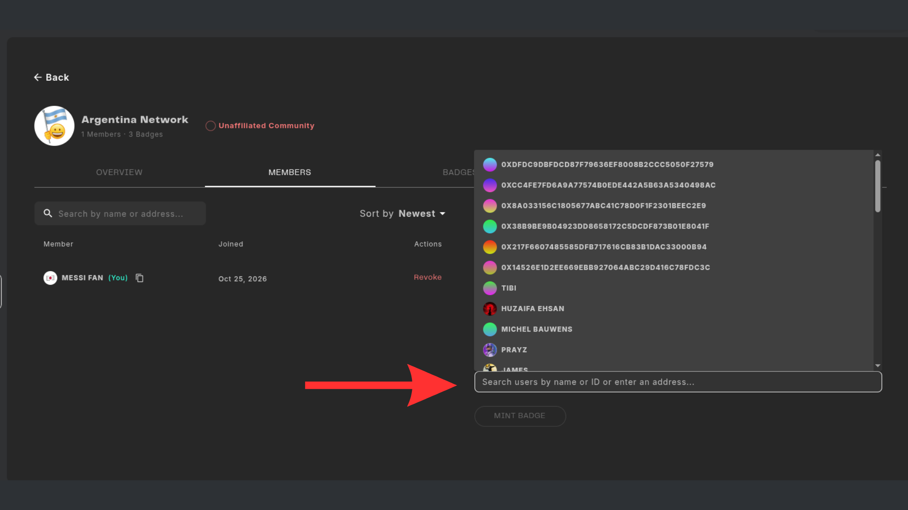
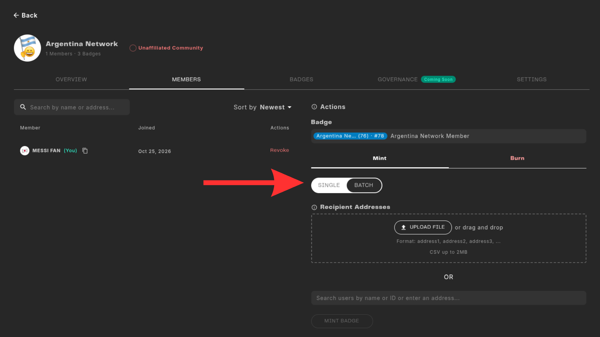

# Add Community Members

The way we add community members to our communities is by minting them a Community Member Badge. 

This guide explains how to complete the minting process for single persons or a group of people. 

## Prerequisites
The people you want to add must have an account in the Web3 Outpost. You also need Manager permissions on the community to mint badges. 

## Step-by-Step Guide

### Step 1

Go to your Community dashboard and select the "Members" toogle. 

### Step 2
In the right side you will find the column for Actions. You can Mint and Burn in this section. In the Badge selection choose the badge you want to mint. In this case we will use the Member Badge since we want to start getting people into our community.

### Step 3
The recipient adress section will display a full list of addresses who have an account inside the web3 Outpost. This list is filterable and searchable. If you found the person you want to assign that badge select him and click the button "Mint Badge".

### Step 4
In case you want to Mint your member badge in a batch then just select that option and upload a CSV file with all the adress you want to add. (Again, those adresses must have an account in the Web3 Outpost to receive the badge and follow the format explained on the Web3 Outpost).

